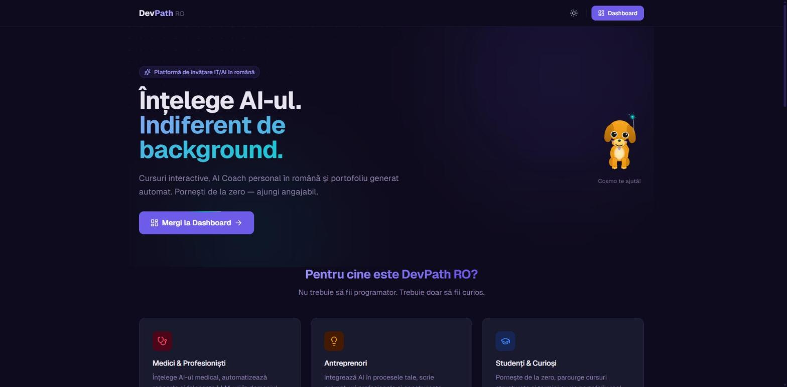

# DevPath RO

**Gamified IT & AI learning platform in Romanian.** From "I know nothing" to real technical thinking — interactive lessons, a personal AI coach, and code that runs right in the browser.

🔗 **Live demo:** https://devpath-ro.vercel.app



---

## About

DevPath RO helps Romanian beginners understand how computers and AI actually work, with no technical background required. The content is a gamified progress map: **6 courses, 131 interactive lessons** — from hardware and operating systems to Python, algorithms, and math for AI.

## Features

- 🧭 **"Serpentine" progress map** — 131 lessons across 6 courses, with XP, levels, streaks, and badges
- 🐍 **In-browser Python editor** — runs real code client-side (Pyodide in a Web Worker), with an infinite-loop guard
- 🤖 **AI Coach** — a conversational tutor in Romanian, powered by Anthropic Claude
- ❓ **AI-generated adaptive quizzes** — on-topic questions with explanations, cached per lesson
- 🔐 **Auth & security** — email + Google OAuth (Supabase), with Row-Level Security
- 📜 Certificates, auto-generated portfolio, leaderboard, glossary, and flashcards

## Tech stack

**Next.js** (App Router · React Server Components) · **TypeScript** · **Tailwind CSS** · **Supabase** (Postgres · Auth · RLS) · **Anthropic Claude API** · deployed on **Vercel**

## Run locally

```bash
git clone https://github.com/MareBogdan/devpath-ro.git
cd devpath-ro
npm install
cp .env.example .env.local   # add your Supabase + Anthropic keys
npm run dev                  # http://localhost:3000
```

## Status

Personal project, live in production. 6 courses (131 lessons) published; more in progress.

---

Built by [Mare Bogdan](https://github.com/MareBogdan).
